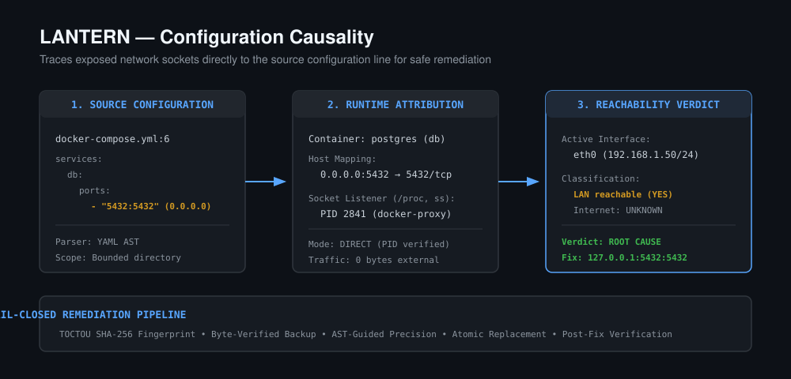

# Lantern

> See exactly why your development machine exposes a service — and safely fix it.

[](https://github.com/DhyaanKanoja11/Lantern/actions/workflows/ci.yml)
[](https://github.com/DhyaanKanoja11/Lantern/releases)
[](https://github.com/marketplace/actions/lantern-security-scan)
[](go.mod)
[](LICENSE)
[](#8-supported-platforms-and-limitations)

Lantern is a local-first security CLI for developers. Instead of merely listing listening port numbers, Lantern traces **configuration causality**: identifying the exact file and source line in your Docker Compose configuration, container mapping, process, and host network interface responsible for exposing a service, and providing safe, deterministic remediation.

> **Deep Dive**: Read the architectural breakdown on [Why Docker Silently Binds to 0.0.0.0 (And How to Trace Port Causality in Go)](https://dev.to/dhyaan_k/why-docker-silently-binds-to-0000-and-how-to-trace-port-causality-in-go-26p9).



---

## 1. The Problem

During local software development, services frequently publish ports to wildcard addresses (`0.0.0.0` or `::`) instead of loopback (`127.0.0.1`):

```yaml
# A common docker-compose.yml configuration
services:
  db:
    image: postgres:16-alpine
    ports:
      - "5432:5432" # Binds to 0.0.0.0:5432 on all host interfaces
```

When this occurs, databases, caches, message brokers, and debug endpoints intended solely for local workstation use become reachable across the local office Wi-Fi, home network, or VPN subnet.

Standard diagnostic tools like `ss`, `netstat`, or `lsof` can tell you that port 5432 is open. However, they cannot answer:
- **Which container or process published it?**
- **Which configuration file and source line caused it?**
- **Is it reachable from the LAN, VPN, or only localhost?**
- **How can I safely restrict it to localhost without breaking my configuration?**

Lantern was built to solve this problem from the inside out.

---

## 2. Approach: Configuration Causality

Lantern operates passively on your workstation without generating external network traffic:

1. **Passive Socket Collection**: Discovers active TCP listening sockets directly from the operating system (`ss` and `/proc/net/tcp`).
2. **Process & Container Attribution**: Attributes sockets to processes and Docker containers (`docker-proxy` or direct process FDs).
3. **Causal Source-Line Resolution**: Parses Docker Compose files using YAML Abstract Syntax Tree (AST) parsing to locate the exact service declaration and line number.
4. **Reachability Classification**: Enumerates host network interfaces (`net.Interfaces()`) to classify whether a listening socket is restricted to loopback (`127.0.0.1`), accessible to the local network (`LAN reachable`), or bound to a VPN.
5. **Fail-Closed Remediation**: Provides `lantern fix` to restrict wildcard Docker Compose bindings to `127.0.0.1:5432:5432` with cryptographic TOCTOU checks, byte-verified backups, and atomic writes.

---

## 3. Terminal Demonstration

### Discovery (`lantern scan`)

```text
$ lantern scan
PORT    ADDRESS    PROCESS         CONTAINER    REACHABILITY
5432    0.0.0.0    docker-proxy    postgres     LAN reachable
8080    127.0.0.1  node            -            localhost only
```

### Causal Explanation (`lantern why 5432`)

```text
$ lantern why 5432
postgres :5432

EXPOSURE PATH

docker-compose.yml
       ↓
5432:5432
       ↓
Docker container: postgres
       ↓
0.0.0.0:5432
       ↓
eth0 (192.168.1.50)
       ↓
LAN reachable

ROOT CAUSE

/home/user/app/docker-compose.yml:6

    5432:5432

REACHABILITY

Local machine: YES
LAN:           YES
Internet:      UNKNOWN

RECOMMENDED CHANGE

    127.0.0.1:5432:5432

Bind published port to localhost (127.0.0.1) in /home/user/app/docker-compose.yml to prevent local network exposure.
```

### Safe Remediation Preview (`lantern fix 5432 --dry-run`)

```text
$ lantern fix 5432 --dry-run
Lantern Fix

Port: 5432
Root cause: /home/user/app/docker-compose.yml:6

Current:
    5432:5432

Proposed:
    127.0.0.1:5432:5432

This will modify:
    /home/user/app/docker-compose.yml

Dry-run mode: no changes will be made.
Backup that would be created: /home/user/app/docker-compose.yml.lantern.bak
```

### Applying Remediation (`lantern fix 5432`)

```text
$ lantern fix 5432
Lantern Fix

Port: 5432
Root cause: /home/user/app/docker-compose.yml:6

Current:
    5432:5432

Proposed:
    127.0.0.1:5432:5432

This will modify:
    /home/user/app/docker-compose.yml

A backup will be created before modification.

Apply this change? [y/N]: y

Fix applied successfully.

Before:
    5432:5432

After:
    127.0.0.1:5432:5432

Backup:
    /home/user/app/docker-compose.yml.lantern.bak
```

### Context-Aware Port Freeing (`lantern free 5432` / `lantern kill 5432`)

Blunt utilities (`kill -9` or `npx kill-port`) blindly terminate processes. When a port is owned by Docker, killing `docker-proxy` corrupts Docker's userland networking state. Lantern Free inspects what actually owns the port before taking action:
- If held by a **Docker container**, it stops the container cleanly via the Docker API.
- If held by a **native process**, it safely terminates the process.

```bash
$ lantern free 5432
Port 5432 is currently occupied by Docker container:
  Container: postgres-dev (ID: c1234567890a)
  Image:     postgres:16-alpine
  Project:   my-backend (service: db)

Stop this container? [y/N]: y
[OK] Docker container "postgres-dev" stopped. Port 5432 is now free.
```

Preview without taking action using `--dry-run`, or bypass prompts in scripts using `-f` / `--force`:
```bash
lantern free 5432 --dry-run
lantern free 5432 -f
```

---

## 4. Installation

### Option A: Shell Installer (Linux, macOS, WSL2)

The fastest way to install or update Lantern:

```bash
curl -fsSL https://raw.githubusercontent.com/DhyaanKanoja11/Lantern/main/install.sh | bash
```

The script automatically:
- Detects operating system and architecture (`amd64` / `arm64`).
- Downloads the official release binary.
- Verifies cryptographic integrity against `checksums.txt` (SHA-256).
- Installs to `/usr/local/bin` (or `~/.local/bin` if running without root privileges).
- Verifies whether the installation path is present in `$PATH`, detecting your shell environment (`bash`, `zsh`, `fish`) and providing exact copy-pasteable persistence commands when necessary.

To install a specific version:
```bash
curl -fsSL https://raw.githubusercontent.com/DhyaanKanoja11/Lantern/main/install.sh | LANTERN_VERSION=v0.3.0 bash
```

To uninstall:
```bash
curl -fsSL https://raw.githubusercontent.com/DhyaanKanoja11/Lantern/main/install.sh | bash -s -- --uninstall
```

### Option B: Homebrew (macOS & Linuxbrew)

Install via the official tap:

```bash
brew tap DhyaanKanoja11/tap
brew install lantern
```

To upgrade:
```bash
brew upgrade lantern
```

### Option C: Windows Package Managers

#### 1-Line PowerShell Installer
The fastest way to install or update Lantern on Windows:
```powershell
irm https://raw.githubusercontent.com/DhyaanKanoja11/Lantern/main/install.ps1 | iex
```

#### Scoop
Install via the official Scoop bucket:
```powershell
scoop bucket add dhyaan https://github.com/DhyaanKanoja11/scoop-bucket
scoop install lantern
```

Or install directly via the standalone manifest:
```powershell
scoop install https://raw.githubusercontent.com/DhyaanKanoja11/Lantern/main/packaging/scoop/lantern.json
```

#### WinGet *(Submission Pending Review)*
Once approved in `microsoft/winget-pkgs`:
```powershell
winget install DhyaanKanoja11.Lantern
```
*(Manifest is available in [`packaging/winget/`](packaging/winget/)).*

### Option D: Linux Packages (.deb, .rpm, AUR)

- **Arch Linux (AUR)**:
  ```bash
  yay -S lantern-bin
  ```
  *(PKGBUILD is available in [`packaging/aur/`](packaging/aur/)).*

- **Debian / Ubuntu (.deb)**:
  Download the `.deb` archive from [Releases](https://github.com/DhyaanKanoja11/Lantern/releases) and install:
  ```bash
  sudo dpkg -i lantern_<version>_linux_amd64.deb
  ```

- **Fedora / RHEL (.rpm)**:
  Download the `.rpm` archive from [Releases](https://github.com/DhyaanKanoja11/Lantern/releases) and install:
  ```bash
  sudo rpm -i lantern_<version>_linux_amd64.rpm
  ```

### Option E: Pre-Compiled Release Binaries

Download standalone pre-compiled archives directly from the [Releases](https://github.com/DhyaanKanoja11/Lantern/releases) page:

| Platform | Architecture | Archive |
| :--- | :--- | :--- |
| **Linux** | `x86_64` (AMD64) | `lantern_<version>_linux_amd64.tar.gz` |
| **Linux** | `aarch64` (ARM64) | `lantern_<version>_linux_arm64.tar.gz` |
| **macOS** | Apple Silicon (`arm64`) | `lantern_<version>_darwin_arm64.tar.gz` |
| **macOS** | Intel (`amd64`) | `lantern_<version>_darwin_amd64.tar.gz` |
| **Windows** | `x86_64` (AMD64) | `lantern_<version>_windows_amd64.zip` |

Verify archive integrity:
```bash
sha256sum --ignore-missing -c checksums.txt
```

### Option F: Go Install or Build from Source (Go 1.22+)

Install directly via `go install`:

```bash
go install github.com/DhyaanKanoja11/Lantern/cmd/lantern@latest
```

Or clone the repository and build from source:

```bash
git clone https://github.com/DhyaanKanoja11/Lantern.git
cd Lantern
go install ./cmd/lantern
```

Ensure your Go bin directory is in your `PATH`:
```bash
export PATH="$(go env GOPATH)/bin:$PATH"
```

---

## 5. Quick-Start Example

A self-contained demo configuration is provided in [`examples/`](examples/):

```bash
# 1. Start a demo PostgreSQL database with a wildcard port binding (0.0.0.0:5432)
cd examples
docker compose up -d

# 2. Check environment prerequisites
lantern doctor

# 3. Discover exposed listening sockets
lantern scan

# 4. Trace why port 5432 is reachable
lantern why 5432

# 5. Preview safe remediation without writing to disk
lantern fix 5432 --dry-run

# 6. Safely apply the fix (creates verified backup and updates docker-compose.yml)
lantern fix 5432

# 7. Teardown
docker compose down
```

---

## 6. Practical Command Reference

| Command | Description | Example |
| :--- | :--- | :--- |
| `lantern scan` | Discovers active TCP listeners. Supports output formats (`text`, `json`, `sarif`), live watch mode (`-w`), team policy (`.lantern.yaml`), and CI enforcement (`--fail-on-wildcard`). | `lantern scan --format sarif` |
| `lantern why <port>` | Explains the complete causal exposure path from network socket to configuration source line. Supports `--format json` / `--format sarif`. | `lantern why 5432 --json` |
| `lantern free <port>` | Context-aware port freeing: cleanly stops Docker containers or terminates native processes occupying a port. Aliased as `lantern kill`. | `lantern free 5432` |
| `lantern preflight [file]` | Preflight collision checker: detects port conflicts and wildcard exposures before running `docker compose up`. | `lantern preflight compose.yaml --json` |
| `lantern fix <port> [--dry-run]` | Interactively remedies supported Docker Compose wildcard exposures to localhost. | `lantern fix 5432 --dry-run` |
| `lantern mcp` | Starts the Model Context Protocol (MCP) stdio server for AI agents (Claude Code, Cursor, Windsurf). | `lantern mcp` |
| `lantern doctor` | Runs diagnostic probes checking host OS, `ss`, `/proc`, Docker CLI/daemon, and interfaces. | `lantern doctor` |
| `lantern version` | Prints semantic version, commit hash, build date, and target architecture. | `lantern version` |
| `lantern [command] --help` | Displays usage instructions, flag descriptions, and POSIX exit codes. | `lantern why --help` |

### CI/CD Security Guardrails

Prevent accidental wildcard bindings (`0.0.0.0` or `::`) from reaching production by running Lantern in CI using the official [GitHub Marketplace Action](https://github.com/marketplace/actions/lantern-security-scan):

```yaml
- name: Audit Port Exposures
  uses: DhyaanKanoja11/lantern-action@v1
  with:
    fail-on-wildcard: 'true'
    ignore-ports: '80,443'
```

Or run directly via CLI:
```bash
lantern scan --fail-on-wildcard --ignore-ports 80,443
```

When run inside GitHub Actions (`GITHUB_ACTIONS=true`), Lantern automatically emits native [error annotations](https://docs.github.com/en/actions/writing-workflows/choosing-what-your-workflow-does/workflow-commands-for-github-actions) directly on the pull request diff and exits with a non-zero code to block insecure configurations.

#### GitHub Code Scanning & SARIF Integration

Generate standard OASIS SARIF v2.1.0 reports to populate GitHub's native **Security → Code scanning alerts** dashboard:

```bash
lantern scan --format sarif > lantern.sarif
```

Upload the report directly in your GitHub Actions workflow:

```yaml
- name: Audit Port Exposures (SARIF)
  run: lantern scan --format sarif > results.sarif
  continue-on-error: true

- name: Upload to GitHub Security Tab
  uses: github/codeql-action/upload-sarif@v3
  with:
    sarif_file: results.sarif
```

### Team Policy Configuration (`.lantern.yaml`)

Define shared port security rules for your repository by adding a `.lantern.yaml` file to your project root:

```yaml
version: 1
policy:
  fail_on_wildcard: true
  ignore_ports:
    - 80
    - 443
```

When `.lantern.yaml` is present, `lantern scan` automatically applies the policy in local development and CI without requiring long CLI flags.

### Pre-Commit Hook Integration

Automatically audit active ports and prevent committing insecure configurations with [pre-commit](https://pre-commit.com/):

Add to your `.pre-commit-config.yaml`:

```yaml
repos:
  - repo: https://github.com/DhyaanKanoja11/Lantern
    rev: v0.3.0
    hooks:
      - id: lantern-scan
        args: ["--fail-on-wildcard", "--ignore-ports", "80,443"]
```

### Live Terminal Watch Mode

Continuously monitor network listeners and container ports as you start and stop development services:

```bash
lantern scan --watch
# Or specify a custom refresh interval:
lantern scan -w --interval 5s
```

### AI Coding Agent Integration (Model Context Protocol / MCP)

Lantern includes a native **Model Context Protocol (MCP)** stdio server, allowing AI coding assistants—including **Claude Code**, **Claude Desktop**, **Cursor**, and **Windsurf**—to inspect network exposure, trace port causality, and safely reclaim ports during autonomous execution.

#### Adding to Claude Code
Connect Lantern to Claude Code via the CLI:

```bash
claude mcp add lantern lantern mcp
```

#### Adding to Claude Desktop / Cursor / Windsurf
Add the following configuration to your MCP configuration file (`claude_desktop_config.json`, `.cursor/mcp.json`, or `.windsurf/mcp.json`):

```json
{
  "mcpServers": {
    "lantern": {
      "command": "lantern",
      "args": ["mcp"]
    }
  }
}
```

#### Installing via Smithery
```bash
npx -y @smithery/cli install lantern
```

#### Exposed MCP Tools

| Tool Name | Parameters | Description |
| :--- | :--- | :--- |
| `lantern_scan` | *(none)* | Scans active TCP listeners on the host, returning structured process, container, and reachability classifications. |
| `lantern_why` | `port` (int) | Traces causal exposure path for a port down to the exact `docker-compose.yml` service and line number. |
| `lantern_free` | `port` (int), `force` (bool) | Safely reclaims an occupied port by cleanly stopping its Docker container or terminating its host process. |
| `lantern_preflight` | `file_path` (string) | Pre-inspects a Compose file to detect and prevent `EADDRINUSE` port collisions and wildcard exposures before container startup. |
| `lantern_doctor` | *(none)* | Runs diagnostic environment readiness checks for socket collection and Docker connectivity. |


---

## 7. Comparison with Existing Tools

Lantern does not compete with network scanners or socket dumpers; it bridges the gap between low-level socket inspection and developer configuration files:

| Capability | `ss` / `netstat` | `lsof` | `nmap` | **Lantern** |
| :--- | :---: | :---: | :---: | :---: |
| **Inspects local listening sockets** | Yes | Yes | Probes remotely | **Yes** |
| **Attributes socket to Docker container** | No | No | No | **Yes** |
| **Pinpoints source line in Docker Compose** | No | No | No | **Yes** (`ROOT CAUSE`) |
| **Classifies interface reachability (LAN/VPN)** | No | No | Partial | **Yes** |
| **Zero external network traffic (passive inside-out)** | Yes | Yes | No (sends packets) | **Yes** |
| **Deterministic, fail-closed remediation** | No | No | No | **Yes** (`lantern fix`) |

- **`ss` and `netstat`** query kernel socket tables directly. They tell you *that* a socket is open on `0.0.0.0:5432`, but provide no configuration awareness.
- **`lsof`** maps open file descriptors to process IDs, but cannot trace container published ports back to Compose definitions.
- **`nmap`** is an active network scanner that sends network packets over the wire. It answers what an external observer sees, but cannot identify *why* your workstation configuration exposes the service.
- **`Lantern`** inspects the system from the inside out, correlating sockets, processes, container inspect metadata, and YAML configuration files.

---

## 8. Supported Platforms and Limitations

### Operating System Support

| Platform | Support Level | Behavior |
| :--- | :--- | :--- |
| **Linux (kernel 3.10+)** | **Primary** | Full native functionality (`scan`, `why`, `doctor`, `fix`, `free`) via `ss` and `/proc`. |
| **WSL2** | **Primary** | Full native functionality inside WSL2 Linux environments. |
| **macOS** | **Primary** | Full native functionality via `lsof` socket discovery and `ps` process attribution. |
| **Windows** | **Primary** | Full native functionality via Win32 `netstat` socket discovery and `tasklist` process attribution. |

### Technical Capabilities & Guardrails

- **Cross-Platform Socket Inspection**: Socket discovery operates natively without virtual machines: Linux uses `ss` and `/proc/net/tcp`, macOS uses native `lsof -iTCP -sTCP:LISTEN`, and Windows uses native Win32 `netstat -ano -p tcp`.
- **Unprivileged Process Inspection & Inferred Attribution**: When running as an unprivileged user on Linux (UID > 0), root-owned sockets (such as `docker-proxy`) cannot have their PIDs or file descriptors read directly from `/proc`. Lantern automatically falls back to Docker published port metadata inference, clearly tagging the attribution as `INFERRED`, rendering an explicit `ATTRIBUTION NOTICE` explaining the unverified PID in `lantern why`, and restricting `lantern fix` to read-only `--dry-run` diffs until verified with root/sudo.
- **Docker Daemon Diagnostic Guidance**: If the Docker daemon is stopped, socket permission is denied, or the Docker CLI is not installed, `lantern scan` continues to collect and display listening host sockets while rendering actionable diagnostic notices beneath the table.
- **Supported Remediation Scope**: `lantern fix` is strictly designed for Docker Compose configurations. It does not attempt to modify arbitrary native application configurations (e.g., PostgreSQL `postgresql.conf` or Redis `redis.conf`) where configuration syntaxes vary unpredictably.
- **Host Networking (`--net=host`)**: Containers running in host network mode share the host network stack directly. Lantern attributes them only when PID correlation is established.
- **Conservative Reachability**: Wildcard bindings (`0.0.0.0` or `::`) are classified as `LAN reachable` with `Internet: UNKNOWN`. Lantern never claims a service is publicly accessible over the Internet without verified external routing evidence.

---

## 9. Security and Safety Model

The remediation engine (`lantern fix`) is built around a **10-layer fail-closed safety pipeline**:

1. **Read-Only by Default**: Discovery and diagnostic commands (`scan`, `why`, `doctor`, `version`) never write to disk or mutate system state.
2. **Explicit Confirmation**: The interactive prompt defaults to `No` (`[y/N]`). Remediation requires an explicit affirmative answer (`y` or `yes`).
3. **Dry-Run Inspection**: `--dry-run` performs full causal analysis and renders the before/after modification without creating temporary files or backups.
4. **Cryptographic TOCTOU Protection**: Computes a SHA-256 fingerprint of the configuration file during analysis and re-verifies it immediately before writing. If the file was modified, moved, or deleted by another process, Lantern aborts cleanly.
5. **No Automatic Replanning**: If file modification is detected, Lantern never attempts to guess or re-apply a stale plan; it halts and requests that you re-run the command.
6. **Byte-Verified Backup**: Generates a sequenced backup (`docker-compose.yml.lantern.bak`) and verifies byte equality against the original before touching the target file. Existing backups are never overwritten.
7. **YAML AST Precision**: Targets the exact YAML AST node corresponding to the exposed port. Comments, indentation, unrelated services, and environment variables are preserved intact.
8. **AST Invariant Verification**: Validates the modified YAML structure in memory before writing to disk, ensuring that syntax remains valid and only the intended port publication was modified.
9. **Atomic Replacement**: Writes changes to a temporary file in the target directory, calls `sync` to flush data to disk, and replaces the target file via atomic filesystem `rename`.
10. **Post-Fix Verification**: Re-reads the modified file from disk after writing and re-parses it with the Compose parser to verify that the port is bound to `127.0.0.1`. If verification fails, the original backup is preserved and the error is reported.

**Privacy Guarantee**: Lantern performs zero external network telemetry, zero analytics tracking, and runs no background daemons.

---

## 10. Architecture & Development

For an in-depth explanation of Lantern's internal layering, package boundaries, data flows, and design decisions:

- [`ARCHITECTURE.md`](ARCHITECTURE.md) — Layered architecture, domain purity, and data pipeline.
- [Why Docker Silently Binds to 0.0.0.0](https://dev.to/dhyaan_k/why-docker-silently-binds-to-0000-and-how-to-trace-port-causality-in-go-26p9) — DEV Community technical deep dive on port causality and exposure detection.
- [`CONTRIBUTING.md`](CONTRIBUTING.md) — Local development workflow, code style, and PR guidelines.
- [`SECURITY.md`](SECURITY.md) — Security policy and vulnerability disclosure procedures.
- [`CHANGELOG.md`](CHANGELOG.md) — Version history and release notes.

### Verification Suite

All contributions must pass the verification suite:

```bash
# Run unit and hermetic integration tests
go test -count=1 ./...

# Run race condition detector
go test -race ./...

# Run static analysis and formatting checks
go vet ./...
gofmt -s -l .

# Multi-platform compilation check
GOOS=linux GOARCH=amd64 go build ./cmd/lantern
GOOS=linux GOARCH=arm64 go build ./cmd/lantern
GOOS=windows GOARCH=amd64 go build ./cmd/lantern
GOOS=darwin GOARCH=arm64 go build ./cmd/lantern
```

### Contributing

Contributions of all skill levels are welcome! Check out [`CONTRIBUTING.md`](CONTRIBUTING.md) for local environment setup, architecture guidelines, and our [open Good First Issues](https://github.com/DhyaanKanoja11/Lantern/issues?q=is%3Aissue+is%3Aopen+label%3A%22good+first+issue%22).

---

## 11. License

Lantern is licensed under the [MIT License](LICENSE).
